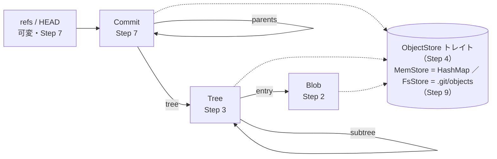

# RustでつくるミニGit：Merkle DAG実装課題

2026-10-25 · haaagiii

## はじめに

10ステップで、本物の`git`が読み書きできるオブジェクトを出力するミニGit（仮称 `mgit`）をRustで作ります。ゴールは、Step 9で`mgit`が書いたcommitを`git log`と`git fsck --strict`が受け入れることです。

各ステップは「狙い・設計ポイント・課題・確認」で構成しています。

- **【課題】** 型とシグネチャだけを示し、本体は`todo!()`にしています。ここを手で書きます。
- **【写経】** Merkle木の理解に関係しない周辺処理（SHA-1/zlibの呼び出し、hex変換、ファイル走査、CLI）です。そのまま写してください。
- **確認** は本物のgitを正解として使います。`git hash-object`、`git write-tree`、`git commit-tree`、`git diff-tree`、`git fsck`の出力と一致すればOKです。

Rustの設計では、次の3つの方針を一貫させます。

1. **ハッシュは型にする**：`[u8; 20]`や`String`のまま持ち回らず、`ObjectId`というnewtypeにする
2. **閉じた集合はenum、型ごとの振る舞いはtrait**：オブジェクト種別・ファイルモード・diff結果はenumにし、エンコード規則は`GitObject`トレイトにする
3. **バイト列層と型付き層を分ける**：ストアは`(kind, bytes)`だけを扱い、型への変換はその上の層で行う

### 型の全体像（各型を作るStep付き）



矢印はすべてObjectId（Step 1、中身のSHA-1）による参照です。子が変わると親のIDも変わり、変更は矢印と逆向きに、葉からルートへ伝播します。ストアに入るBlob・Tree・Commitはすべて不変で、可変なのはストアの外にあるrefs / HEADだけです。

## Step 0 セットアップ【写経】

```bash
cargo new mgit && cd mgit
cargo add sha1 flate2 thiserror anyhow tempfile
cargo add clap --features derive
```

モジュール構成です。最初は空ファイルで構いません。

```text
src/
  main.rs        CLI（Step 9）
  lib.rs         pub mod 宣言
  error.rs       エラー型
  id.rs          ObjectId（Step 1）
  object/        mod.rs, blob.rs, tree.rs, commit.rs（Step 2, 3, 7）
  store/         mod.rs, mem.rs, fs.rs（Step 4, 9）
  worktree.rs    ディレクトリ→Tree（Step 5）
  update.rs      パスコピー更新（Step 6）
  repo.rs        refs・HEAD・履歴（Step 7）
  diff.rs        枝刈りdiff（Step 8）
  fsck.rs        整合性検査（Step 10）
tests/common/mod.rs  本物のgitを呼ぶテストヘルパ
```

`src/error.rs`

```rust
use crate::id::ObjectId;

#[derive(Debug, thiserror::Error)]
pub enum Error {
    #[error("object not found: {0}")]
    NotFound(ObjectId),
    #[error("unexpected kind for {id}: expected {expected}, got {actual}")]
    KindMismatch { id: ObjectId, expected: &'static str, actual: &'static str },
    #[error("hash mismatch: expected {expected}, got {actual}")]
    HashMismatch { expected: ObjectId, actual: ObjectId },
    #[error("parse error: {0}")]
    Parse(String),
    #[error("invalid: {0}")]
    Invalid(String),
    #[error(transparent)]
    Io(#[from] std::io::Error),
}

pub type Result<T> = std::result::Result<T, Error>;
```

`tests/common/mod.rs`（各テストファイルの先頭で`mod common;`）

```rust
use std::path::Path;
use std::process::Command;

pub fn git(dir: &Path, args: &[&str]) -> String {
    let out = Command::new("git")
        .args(args)
        .current_dir(dir)
        .env("GIT_AUTHOR_NAME", "T").env("GIT_AUTHOR_EMAIL", "t@example.com")
        .env("GIT_AUTHOR_DATE", "1700000000 +0900")
        .env("GIT_COMMITTER_NAME", "T").env("GIT_COMMITTER_EMAIL", "t@example.com")
        .env("GIT_COMMITTER_DATE", "1700000000 +0900")
        .output()
        .expect("failed to run git");
    assert!(out.status.success(), "{}", String::from_utf8_lossy(&out.stderr));
    String::from_utf8(out.stdout).unwrap().trim().to_string()
}

pub fn temp_repo() -> tempfile::TempDir {
    let dir = tempfile::tempdir().unwrap();
    git(dir.path(), &["init", "-q"]);
    dir
}
```

署名と日時を環境変数で固定しているので、Step 7でcommitハッシュを`mgit`と突き合わせられます。

## Step 1 ObjectId：ハッシュを型にする

**狙い** Merkle木のノードを指す「ポインタ」を作ります。Gitの参照はすべてこの20バイトです。

**設計ポイント**

- newtype `struct ObjectId([u8; 20])` にすると、ただのバイト列やファイル名の文字列と取り違えなくなります。
- 20バイトの値型なので`Copy`にして構いません。`&ObjectId`と`ObjectId`の使い分けで悩まずに済みます。
- `Ord`と`Hash`をderiveしておくと、`BTreeMap`・`HashSet`のキーにできます。後の重複排除・fsck・diffで多用します。
- `Display`は40桁hex、`Debug`は先頭7桁（`git log --oneline`と同じ）にすると、テスト失敗時の出力が読みやすくなります。

**【写経】hex変換**

```rust
fn to_hex(bytes: &[u8]) -> String {
    bytes.iter().map(|b| format!("{b:02x}")).collect()
}

fn from_hex(s: &str) -> Option<Vec<u8>> {
    if s.len() % 2 != 0 { return None; }
    (0..s.len())
        .step_by(2)
        .map(|i| u8::from_str_radix(s.get(i..i + 2)?, 16).ok())
        .collect()
}
```

**【課題】**

```rust
#[derive(Clone, Copy, PartialEq, Eq, PartialOrd, Ord, Hash)]
pub struct ObjectId([u8; 20]);

impl ObjectId {
    pub const LEN: usize = 20;
    pub fn from_raw(bytes: [u8; 20]) -> Self { Self(bytes) }
    pub fn as_bytes(&self) -> &[u8; 20] { &self.0 }
    pub fn to_hex(&self) -> String { todo!() }
    /// ("ce", "013625...") の組。Step 9でファイルパスに使う
    pub fn loose_path(&self) -> (String, String) { todo!() }
}

impl TryFrom<&[u8]> for ObjectId {        // treeのバイナリから読むときに使う
    type Error = crate::error::Error;
    fn try_from(b: &[u8]) -> Result<Self, Self::Error> { todo!() }
}
impl std::str::FromStr for ObjectId {      // "ce0136...".parse::<ObjectId>()
    type Err = crate::error::Error;
    fn from_str(s: &str) -> Result<Self, Self::Err> { todo!() }
}
impl std::fmt::Display for ObjectId { /* 40桁hex */ }
impl std::fmt::Debug for ObjectId { /* 先頭7桁 */ }
```

**確認**

- `s.parse::<ObjectId>()?.to_string() == s` の往復テスト
- 39桁・41桁・非hex文字が`Err`になること

**考える問い** `from_raw`を`pub`にすると、中身と一致しないIDも作れてしまいます。`pub(crate)`にして「正しく計算されたIDしか外に出ない」型にすべきでしょうか。どこでその保証が崩れるか（パース時など）を考えてみてください。

## Step 2 Blobとハッシュ計算：GitObjectトレイト

**狙い** Merkle木の「ハッシュ関数」を1か所に定義します。Gitのオブジェクトハッシュは次の式だけです。

```text
id = SHA1( "<kind> <bodyのバイト長>\0" ++ body )
```

**設計ポイント**

- 種別ごとに違うのは「bodyのエンコード規則」だけで、ハッシュの付け方は共通です。そこで、トレイトの**デフォルトメソッド**で`id()`を一度だけ実装し、各型には`encode_body`だけを書かせます。
- 種別は**関連定数** `const KIND` で持たせます。インスタンスごとに変わらない性質は値ではなく型に載せます。
- ストアに入れる「どれか1種類のオブジェクト」は`enum Object`で表します。`Box<dyn GitObject>`にしない理由は2つあります。関連定数と`Self: Sized`を要求するメソッドがあるとdyn互換でなくなること、種別が3つで閉じていることです。
- `enum Object`は最初は`Blob`の腕だけで構いません。Step 3・7で腕を足すと、`match`の網羅性チェックが直す場所をすべて教えてくれます。

**【写経】SHA-1の呼び出し**

```rust
use sha1::{Digest, Sha1};

fn sha1_parts(parts: &[&[u8]]) -> [u8; 20] {
    let mut h = Sha1::new();
    for p in parts { h.update(p); }
    h.finalize().into()
}
```

**【課題】**

```rust
#[derive(Clone, Copy, Debug, PartialEq, Eq, Hash)]
pub enum ObjectKind { Blob, Tree, Commit }

impl ObjectKind {
    pub fn as_str(self) -> &'static str { todo!() }      // "blob" / "tree" / "commit"
}
impl std::str::FromStr for ObjectKind { /* todo */ }

/// Merkle木の「ノードのハッシュ」をここで1回だけ定義する
pub fn hash_object(kind: ObjectKind, body: &[u8]) -> ObjectId { todo!() }

pub trait GitObject {
    const KIND: ObjectKind;
    fn encode_body(&self) -> Vec<u8>;
    fn decode_body(body: &[u8]) -> Result<Self> where Self: Sized;

    fn id(&self) -> ObjectId {
        todo!() // hash_object を使う
    }
}

#[derive(Clone, Debug, PartialEq, Eq)]
pub struct Blob { pub data: Vec<u8> }
impl GitObject for Blob { /* todo */ }

#[derive(Clone, Debug, PartialEq, Eq)]
pub enum Object { Blob(Blob) /* , Tree(Tree), Commit(Commit) は後で */ }

impl Object {
    pub fn kind(&self) -> ObjectKind { todo!() }
    pub fn encode_body(&self) -> Vec<u8> { todo!() }
    pub fn id(&self) -> ObjectId { todo!() }
    pub fn decode(kind: ObjectKind, body: &[u8]) -> Result<Self> { todo!() }
}
```

**確認**

- `"hello\n"`のblob → `ce013625030ba8dba906f756967f9e9ca394464a`
- 空のblob → `e69de29bb2d1d6434b8b29ae775ad8c2e48c5391`
- 任意のファイルについて`git hash-object <path>`と一致すること（`tests/common`の`git()`を使う）

**考える問い** headerにバイト長を入れるのはなぜでしょうか。blobとtreeでbodyが偶然同じバイト列だったら、何が起きるでしょうか。

## Step 3 Tree：Merkle木の内部ノード

**狙い** 子のハッシュを並べたノードを作ります。treeのbodyは次のエントリを区切りなしで連結したバイナリです。

```text
<mode(ASCII)> <name>\0<子のObjectId 生20バイト>
```

**ハマりどころ（仕様）**

- ディレクトリのmodeはオブジェクト内では`40000`です（先頭0なし）。`git cat-file -p`の表示は`040000`ですが、そちらは表示用です。
- エントリの並び順は名前のバイト順ですが、**ディレクトリは名前の末尾に`/`があるものとして比較**します。たとえば`foo-bar`（ファイル）、`foo.txt`（ファイル）、`foo/`（ディレクトリ）の順になります。単純な文字列ソートでは`foo`が先頭になり、ハッシュが合いません。
- 空のtreeも有効なオブジェクトです（`4b825dc642cb6eb9a060e54bf8d69288fbee4904`）。ただし作業ツリーからは作りません（Step 5）。

**設計ポイント**

- modeは`enum Mode`にし、`TryFrom<&[u8]>`でパースします。不正な文字列は型に入れません（parse, don't validate）。
- エントリ名は`EntryName`のnewtypeにし、空文字・`/`・`\0`・`.`・`..`を拒否します。
- `BTreeMap`なら名前の一意性が型で保証されますが、今回は自前で管理します。内部表現は`Vec<(EntryName, TreeEntry)>`を**常にGit順で保持**します。フィールドは非公開にし、変更は`from_entries`・`insert`・`remove`経由に限定して、不変条件（Git順で厳密に昇順＝名前の重複なし）を守ります。読み出しは`&[…]`のスライスで渡すので、外から順序を崩せません。
- 検索は`binary_search_by`で行います。ただしGit順は「ディレクトリかどうか」で位置が変わるため、名前だけでは1回で引けません。ファイルとして・ディレクトリとしての2通りを探すのがこの課題の山場です。`insert`でファイル`foo`をディレクトリ`foo`に置き換えるとき、古いエントリは別の位置にある点にも注意してください。
- 各メソッドの最後で`debug_assert!(self.check_invariant())`を呼びます。`windows(2)`か`is_sorted_by`で書けます。
- `decode_body`では読みながら順序を検証し、崩れていれば`Error::Invalid`で拒否します。本物の`git fsck`も順序違反のtreeを報告します。

**【課題】**

```rust
#[derive(Clone, Copy, Debug, PartialEq, Eq)]
pub enum Mode { File, Executable, Symlink, Tree }   // 100644 / 100755 / 120000 / 40000

impl Mode {
    pub fn as_bytes(self) -> &'static [u8] { todo!() }
    pub fn is_tree(self) -> bool { matches!(self, Mode::Tree) }
}
impl TryFrom<&[u8]> for Mode { type Error = Error; /* todo */ }

#[derive(Clone, Debug, PartialEq, Eq, PartialOrd, Ord, Hash)]
pub struct EntryName(String);
impl EntryName { pub fn as_str(&self) -> &str { &self.0 } }
impl TryFrom<&str> for EntryName { type Error = Error; /* todo: 検証 */ }

#[derive(Clone, Copy, Debug, PartialEq, Eq)]
pub struct TreeEntry { pub mode: Mode, pub id: ObjectId }

#[derive(Clone, Debug, Default, PartialEq, Eq)]
pub struct Tree {
    /// 不変条件: git_order で厳密に昇順。外へ &mut を渡さない
    entries: Vec<(EntryName, TreeEntry)>,
}

impl Tree {
    /// 任意の順の Vec から作る。Git順に並べ替え、名前が重複していれば Err
    pub fn from_entries(entries: Vec<(EntryName, TreeEntry)>) -> Result<Self> { todo!() }
    pub fn entries(&self) -> &[(EntryName, TreeEntry)] { &self.entries }
    pub fn get(&self, name: &str) -> Option<&TreeEntry> { todo!() }       // 二分探索を2通り
    pub fn insert(&mut self, name: EntryName, e: TreeEntry) -> Option<TreeEntry> { todo!() }
    pub fn remove(&mut self, name: &str) -> Option<TreeEntry> { todo!() }
    pub fn is_empty(&self) -> bool { self.entries.is_empty() }
    fn check_invariant(&self) -> bool { todo!() }
}

/// Git順の比較。ヒント: Iterator::cmp と bool::then_some で1〜2行
fn git_order(a: &str, a_is_tree: bool, b: &str, b_is_tree: bool) -> std::cmp::Ordering { todo!() }

impl GitObject for Tree {
    const KIND: ObjectKind = ObjectKind::Tree;
    fn encode_body(&self) -> Vec<u8> { todo!() }       // 不変条件があるので順に書くだけ
    fn decode_body(body: &[u8]) -> Result<Self> { todo!() }   // 順序違反は Err
}
```

`decode_body`のヒント：`rest.iter().position(|&b| b == b' ')`で区切りを探し、`split_at`で切り進めます。最後の20バイトは`ObjectId::try_from`に渡します。

**確認**

- `Tree::default().id()`が空treeのハッシュと一致すること
- `encode → decode → encode`でバイト列が変わらないこと
- 一時リポジトリに`foo-bar`、`foo.txt`、`foo/x`を作り、`git add -A && git write-tree`の結果と、自分で組んだtreeの`id()`が一致すること（ソート順の検証）

## Step 4 ObjectStoreトレイトとMemStore：重複排除

**狙い** 「ハッシュ → 中身」の辞書を作ります。content-addressableなので、同じ中身を2回入れても1つしか増えません。

**設計ポイント**

- トレイトは**バイト列層**（`put_raw`/`get_raw`）だけを必須メソッドにし、**型付き層**（`put<T>`/`get<T>`）はデフォルト実装で上に載せます。ストアの実装者はオブジェクトの型を知らずに済みます。
- `get::<Tree>(&id)`のように型引数で取り出す型を指定し、種別が違えば`Error::KindMismatch`を返します。
- ジェネリックなデフォルトメソッドがあると、そのままでは`dyn ObjectStore`にできません。dynでも使いたい場合は`where Self: Sized`を付けます。本課題ではジェネリクス（`S: ObjectStore`）で通します。
- `put`は`&mut self`にします。`&self`＋内部可変性（`RefCell`/`RwLock`）にするかは発展課題Fで扱います。
- `Object`に`Tree`の腕を足しておきます。

**【課題】**

```rust
pub trait ObjectStore {
    fn put_raw(&mut self, kind: ObjectKind, body: &[u8]) -> Result<ObjectId>;
    fn get_raw(&self, id: &ObjectId) -> Result<Option<(ObjectKind, Vec<u8>)>>;
    /// fsckで全件走査するため
    fn ids(&self) -> Result<Vec<ObjectId>>;

    fn contains(&self, id: &ObjectId) -> Result<bool> { todo!() }
    fn put<T: GitObject>(&mut self, obj: &T) -> Result<ObjectId> { todo!() }
    fn get<T: GitObject>(&self, id: &ObjectId) -> Result<T> { todo!() }   // 無ければ NotFound
    fn get_object(&self, id: &ObjectId) -> Result<Object> { todo!() }     // 種別が不明なとき
}

#[derive(Default)]
pub struct MemStore { objects: HashMap<ObjectId, (ObjectKind, Vec<u8>)> }

impl MemStore {
    pub fn len(&self) -> usize { self.objects.len() }
}
impl ObjectStore for MemStore { /* todo */ }
```

**確認**

- 同じblobを2回`put`しても`len() == 1`で、返るIDも同じこと
- blobを1つ持つtreeを`put`し、`get::<Tree>`で取り出したtreeから辿ったblobが元と一致すること
- blobのIDを`get::<Tree>`すると`KindMismatch`になること

**考える問い** `put_raw`の中でIDを計算するのは、呼び出し側ではなくストア側であるべきでしょうか。呼び出し側がIDを渡す設計にすると、何が壊れうるでしょうか。

## Step 5 作業ディレクトリからTreeを組み立てる

**狙い** ディレクトリを再帰的にMerkle木へ変換します。子のハッシュが決まらないと親のbodyが書けないため、**帰りがけ順（post-order）以外では組み立てられない**ことを体感するステップです。

**設計ポイント**

- ファイル走査は写経で済ませ、課題は「子のIDを集めて親を作る」再帰に集中します。
- Gitは空ディレクトリを追跡しません。子が空になったtreeは親に載せません。戻り値を`Option<ObjectId>`にすると、この規則を自然に表現できます。
- 関数は`S: ObjectStore`のジェネリクスにします。テストはMemStore、Step 9以降はFsStoreで同じコードが動きます。

**【写経】ディレクトリ走査**

```rust
pub enum FsEntry {
    File { name: String, path: PathBuf, executable: bool },
    Dir { name: String, path: PathBuf },
}

pub fn read_dir_entries(dir: &Path) -> Result<Vec<FsEntry>> {
    let mut out = Vec::new();
    for e in std::fs::read_dir(dir)? {
        let e = e?;
        let name = e.file_name().to_string_lossy().into_owned();
        if name == ".git" { continue; }
        let ft = e.file_type()?;
        if ft.is_dir() {
            out.push(FsEntry::Dir { name, path: e.path() });
        } else if ft.is_file() {
            #[cfg(unix)]
            let executable = {
                use std::os::unix::fs::PermissionsExt;
                e.metadata()?.permissions().mode() & 0o111 != 0
            };
            #[cfg(not(unix))]
            let executable = false;
            out.push(FsEntry::File { name, path: e.path(), executable });
        }
        // シンボリックリンクは今回は扱わない
    }
    Ok(out)
}
```

**【課題】**

```rust
/// 空ディレクトリ（中身が空になるもの含む）は None
pub fn write_tree<S: ObjectStore>(store: &mut S, dir: &Path) -> Result<Option<ObjectId>> {
    todo!()
    // 1. read_dir_entries
    // 2. File → Blob を put して TreeEntry に
    // 3. Dir  → write_tree を再帰。Some(id) のときだけ Mode::Tree で載せる
    // 4. 自分の Tree を put
}
```

**確認**

- 一時リポジトリに、3階層のディレクトリ・実行ビット付きファイル・空ディレクトリを作ります。`git add -A && git write-tree`の結果と`write_tree`の戻り値が一致すること
- 同じ内容のファイルを別名で10個置いても、MemStoreのblobが1つしか増えないこと

**考える問い** 行きがけ順（親を先に作る）で実装しようとすると、どこで詰まるでしょうか。

## Step 6 イミュータブル更新（パスコピー）：Merkle性の核心

**狙い** 「葉を1つ変えるとルートまでのパス上のノードだけが作り直され、残りは共有される」ことを、自分のコードと数字で確認します。このドキュメントで最も重要なステップです。

**設計ポイント**

- 既存のtreeは書き換えません。新しいtreeを作って新しいルートIDを返すので、古いルートIDはそのまま有効です（永続データ構造）。
- パスは`&[EntryName]`で受け取り、**スライスパターン**で再帰します：`match path { [] => …, [name] => …, [head, rest @ ..] => … }`
- 途中のディレクトリが無ければ空treeから作ります。削除で空になったtreeは親から外します（Step 5と同じ規則）。
- 計測には**デコレータ**を使います。`CountingStore<S>`が`ObjectStore`を実装して内側へ委譲し、`put`の回数と「新規に増えた数」を数えます。

**【課題】**

```rust
pub enum Change { Put { mode: Mode, id: ObjectId }, Remove }

/// root: None は空のツリー。戻り値 None は結果が空
pub fn update_path<S: ObjectStore>(
    store: &mut S,
    root: Option<ObjectId>,
    path: &[EntryName],
    change: Change,
) -> Result<Option<ObjectId>> {
    todo!()
}

pub struct CountingStore<S> { pub inner: S, pub puts: usize, pub new_objects: usize, pub gets: usize }
impl<S: ObjectStore> ObjectStore for CountingStore<S> { /* 委譲しつつ数える */ }
```

**実験と確認**

1. `a/b/c/file.txt`を含む約1,000ファイルのツリーで1ファイルだけ変更し、`new_objects`が「blob 1個 + パス上のtree数（ルート含む）」になること
2. 変更していない兄弟サブツリーのIDが、更新前後で同じであること
3. **プロパティテスト**：同じ変更を実ファイルに加えて`write_tree`し直した結果と、`update_path`の結果が一致すること
4. **元に戻す実験**：元のblobで再度`update_path`すると、ルートIDが更新前の値に戻ること（同じ内容なら同じハッシュ）

**考える問い** 同じことを`Rc<Node>`の木で実装した場合と比べてください。ハッシュで参照する設計にすると、得られるもの（重複排除・同一性判定がO(1)・永続化）と失うもの（参照のたびにストアを引くコスト）は何でしょうか。

## Step 7 Commit・refs・履歴Iterator

**狙い** treeのルートに「親commitのハッシュ」を足して、スナップショットを鎖でつなぎます。commitのbodyはテキストです。

```text
tree <hex>
parent <hex>          ← 0個以上（マージなら2個）
author <name> <<email>> <unix秒> <+0900>
committer <name> <<email>> <unix秒> <+0900>
                      ← 空行
<message>
```

**設計ポイント**

- `Commit`はtreeと親を`ObjectId`で持ちます。commit同士が鎖になるので、全体はDAGです。
- **可変なのはrefだけ**です。`Repo<S>`がストア（不変）とrefs（可変）を持つ構造にし、型の上でも分けます。HEADは`enum Head { Attached(String), Detached(ObjectId) }`で表します。
- 履歴の走査は`impl Iterator`にします。読み出しが失敗しうるので、`Item = Result<…>`にして`collect::<Result<Vec<_>>>()`で受けます。
- 実際のcommitには`gpgsig`などの追加ヘッダもあります。`decode → encode`が1バイトでもずれるとハッシュが変わるため、知らないヘッダも`extra: Vec<(String, String)>`で保持する**ロスレスなパース**が必要になります（Step 9で本物のcommitを読むとき）。

**【写経】署名行**

```rust
#[derive(Clone, Debug, PartialEq, Eq)]
pub struct Signature { pub name: String, pub email: String, pub time: i64, pub tz_offset_min: i32 }

impl Signature {
    pub fn encode(&self) -> String {
        let sign = if self.tz_offset_min < 0 { '-' } else { '+' };
        let m = self.tz_offset_min.abs();
        format!("{} <{}> {} {}{:02}{:02}", self.name, self.email, self.time, sign, m / 60, m % 60)
    }
    pub fn parse(s: &str) -> Option<Self> {
        let (name, rest) = s.split_once(" <")?;
        let (email, rest) = rest.split_once("> ")?;
        let (time, tz) = rest.split_once(' ')?;
        let sign = if tz.starts_with('-') { -1 } else { 1 };
        let h: i32 = tz.get(1..3)?.parse().ok()?;
        let m: i32 = tz.get(3..5)?.parse().ok()?;
        Some(Self { name: name.into(), email: email.into(), time: time.parse().ok()?, tz_offset_min: sign * (h * 60 + m) })
    }
}
```

**【課題】**

```rust
#[derive(Clone, Debug, PartialEq, Eq)]
pub struct Commit {
    pub tree: ObjectId,
    pub parents: Vec<ObjectId>,
    pub author: Signature,
    pub committer: Signature,
    pub message: String,
}
impl GitObject for Commit { /* todo */ }

pub struct Repo<S> { pub store: S, pub refs: BTreeMap<String, ObjectId>, pub head: Head }

impl<S: ObjectStore> Repo<S> {
    pub fn head_commit(&self) -> Option<ObjectId> { todo!() }
    /// 現在のHEADを親にcommitを作り、ブランチを進める
    pub fn commit(&mut self, tree: ObjectId, message: &str, sig: &Signature) -> Result<ObjectId> { todo!() }
    pub fn ancestors(&self, from: ObjectId) -> Ancestors<'_, S> { todo!() }
}

pub struct Ancestors<'a, S> { store: &'a S, queue: VecDeque<ObjectId>, seen: HashSet<ObjectId> }
impl<'a, S: ObjectStore> Iterator for Ancestors<'a, S> {
    type Item = Result<(ObjectId, Commit)>;
    fn next(&mut self) -> Option<Self::Item> { todo!() }
}
```

**確認**

- `git commit-tree <tree> -m msg`（`tests/common`の固定署名）と、`mgit`で作ったcommitのIDが一致すること。`-m`はメッセージ末尾に改行を付ける点に注意してください
- 3コミットの履歴を`ancestors`で辿ると、新しい順に3件返ること

**実験：履歴改変の連鎖** 3コミットの真ん中のメッセージだけを変える`reword(repo, target, msg)`を書いてください。子のcommitも作り直さないとブランチが新しい履歴を指せないこと、結果として**改変点より後のIDがすべて変わる**ことを確認します。rebase後にforce pushが必要になる理由そのものです。

## Step 8 枝刈りdiff

**狙い** 2つのtreeを比較し、**IDが同じサブツリーは中を見ずに飛ばす**diffを書きます。「変わっていなければハッシュが一致する」性質を高速化に使う側の体験です。

**設計ポイント**

- 冒頭の`if a == b { return Ok(vec![]) }`の1行が枝刈りの本体です。
- 両側のエントリはStep 3の不変条件でGit順に並んでいるので、**マージジョイン**で突き合わせます。`Peekable`を2本持ち、`match (a.peek(), b.peek())`の中で`git_order`の`Ordering`を見て進めます。同名のファイルとディレクトリは別の位置に来るので、型変化は自然に「削除＋追加」として現れます。
- 結果は`enum DiffEntry`にします。
- まず手で書き、その後`itertools::merge_join_by`（`EitherOrBoth`）で書き直して比べると、Rustのイテレータ設計の勉強になります。

**【課題】**

```rust
#[derive(Debug, PartialEq, Eq)]
pub enum DiffEntry {
    Added { path: String, id: ObjectId },
    Deleted { path: String, id: ObjectId },
    Modified { path: String, old: ObjectId, new: ObjectId },
}

pub fn diff_trees<S: ObjectStore>(
    store: &S,
    a: Option<ObjectId>,
    b: Option<ObjectId>,
) -> Result<Vec<DiffEntry>> {
    todo!()
    // 片側にしかないディレクトリは、配下の全blobを Added / Deleted として列挙する
}
```

**確認**

- 2つのcommitのtreeについて、`git diff-tree -r --name-status <a> <b>`と同じ集合になること（`A`/`D`/`M`に対応）
- `CountingStore`で`gets`を数えます。1,000ファイルのうち1ファイルの変更なら、読むtreeは「パスの深さ×2」程度で済むこと

**発展** 再帰をやめて明示的なスタックにし、`diff_trees`を遅延評価の`impl Iterator<Item = Result<DiffEntry>>`にしてください。最初の差分だけ欲しい場合（`git diff --quiet`相当）に、全体を走査せずに止まれるようになります。

## Step 9 FsStore（zlib）と本物のGitとの互換

**狙い** `.git/objects`をそのまま読み書きするストアを作り、`mgit`と`git`が同じリポジトリを共有できる状態にします。ここまでのコードは`S: ObjectStore`で書いてあるので、差し替えるだけで動くはずです。

**仕様**

- loose object：`.git/objects/<IDの先頭2桁>/<残り38桁>`に、`"<kind> <len>\0" ++ body`をzlib圧縮して置きます。
- ref：`.git/refs/heads/<branch>`に`<hex>\n`を書きます。`.git/HEAD`は`ref: refs/heads/<branch>\n`です（デフォルトブランチ名は環境によって`main`か`master`なので、HEADから読みます）。
- `git gc`後のリポジトリはpackfileに入るため、loose objectだけでは読めません。本課題では作りたてのリポジトリだけを対象にします。

**設計ポイント**

- 重複排除は「ファイルが既に存在すればスキップ」で実現できます。同じパスには同じ中身しか入らないからです。
- 書き込みは一時ファイル＋renameにして、途中で落ちても壊れたオブジェクトを残さないようにします。

**【写経】zlibとアトミック書き込み**

```rust
use flate2::{read::ZlibDecoder, write::ZlibEncoder, Compression};
use std::io::{Read, Write};

fn compress(data: &[u8]) -> std::io::Result<Vec<u8>> {
    let mut e = ZlibEncoder::new(Vec::new(), Compression::default());
    e.write_all(data)?;
    e.finish()
}

fn decompress(data: &[u8]) -> std::io::Result<Vec<u8>> {
    let mut out = Vec::new();
    ZlibDecoder::new(data).read_to_end(&mut out)?;
    Ok(out)
}

fn write_atomic(path: &Path, bytes: &[u8]) -> std::io::Result<()> {
    let dir = path.parent().expect("has parent");
    std::fs::create_dir_all(dir)?;
    let mut tmp = tempfile::NamedTempFile::new_in(dir)?;
    tmp.write_all(bytes)?;
    tmp.persist(path).map_err(|e| e.error)?;
    Ok(())
}
```

**【写経】CLI（clap）**

```rust
#[derive(clap::Parser)]
struct Cli { #[command(subcommand)] cmd: Cmd }

#[derive(clap::Subcommand)]
enum Cmd {
    HashObject { path: PathBuf, #[arg(short)] write: bool },
    CatFile { #[arg(short)] pretty: bool, id: String },
    WriteTree,
    CommitTree { tree: String, #[arg(short)] parent: Vec<String>, #[arg(short)] message: String },
    Commit { #[arg(short)] message: String },
    Log,
    DiffTree { a: String, b: String },
    Fsck,
}
```

`main`の振り分けは、ここまでの関数を呼ぶだけなので各自で書いてください。

**【課題】**

```rust
pub struct FsStore { objects_dir: PathBuf }

impl FsStore {
    pub fn open(git_dir: &Path) -> Self { todo!() }
    /// "<kind> <len>\0<body>" を分解し、len と実際の長さを検証する
    fn parse_loose(raw: &[u8]) -> Result<(ObjectKind, Vec<u8>)> { todo!() }
}
impl ObjectStore for FsStore { /* todo */ }

pub struct FsRefs { git_dir: PathBuf }
impl FsRefs {
    pub fn read_head(&self) -> Result<Head> { todo!() }
    pub fn read_ref(&self, name: &str) -> Result<Option<ObjectId>> { todo!() }
    pub fn write_ref(&self, name: &str, id: ObjectId) -> Result<()> { todo!() }
}
```

**確認（このドキュメントのゴール）**

1. `git init`した一時リポジトリにファイルを置き、`mgit write-tree`と`mgit commit -m ...`を実行する
2. `git log --stat`に自分のcommitが表示されること
3. `git fsck --strict`がエラーを出さないこと
4. 逆方向：`git commit`で作った履歴を`mgit log`と`mgit cat-file -p`で読めること

## Step 10 fsckと改ざん検知

**狙い** 「ルートのハッシュ1つを信頼すれば、配下全体の正しさを検証できる」ことを、自分で改ざんして確かめます。

**設計ポイント**

- 検査項目ごとに結果を分け、`FsckReport`に溜めます。最初のエラーで`?`で抜けると、壊れたリポジトリの全体像が見えないためです。
- ストアの`get_raw`は検証せずに返し、fsckの側で`hash_object(kind, body) == id`を確かめます。読み出しのたびに検証するかどうかは性能とのトレードオフです（Gitは通常の読み出しでは検証しません）。

**【課題】**

```rust
#[derive(Debug, Default)]
pub struct FsckReport {
    pub corrupt: Vec<ObjectId>,                 // 再計算したハッシュが一致しない
    pub missing: Vec<(ObjectId, ObjectId)>,     // (参照元, 見つからない参照先)
    pub bad_mode: Vec<(ObjectId, String)>,      // Mode::Tree なのに中身が blob など
    pub dangling: Vec<ObjectId>,                // どのrefからも到達しない
}

pub fn fsck<S: ObjectStore>(store: &S, roots: &[ObjectId]) -> Result<FsckReport> { todo!() }
```

**実験**

1. MemStoreに`#[cfg(test)] fn tamper(&mut self, id, new_body)`を足し、深い階層のblobの中身だけを差し替えます。fsckが`corrupt`として検出すること
2. FsStoreでも同じことを行い（ファイルを別内容で再圧縮して上書き）、本物の`git fsck`のメッセージと比べます
3. **改ざんを隠せるか**：差し替えたblobに合わせて、親tree → … → commit → refまで作り直せばfsckは通ります。ただしcommit IDが変わるので、元のIDを知っている人（署名付きタグ、リモート、CIのログ）には必ず気付かれます。この「ルートのIDを持っている人には改ざんを隠せない」性質を、テストとして表現してみてください

## 発展課題

Step 10までで基本のMerkle DAGは完成です。以下は興味に応じて、どれからでも取り組めます。

| 課題 | 内容 | Rust的な学び | 確認方法 |
| --- | --- | --- | --- |
| A. fetchネゴシエーション | 2つのMemStore（client/server）の間で、`wants`から辿り`haves`から到達可能な所で枝を止めて、不足オブジェクトだけを列挙・転送する | `HashSet`による到達可能性計算、借用が2つのストアにまたがる設計 | 転送後にclient側の`fsck`が通ること、転送数が差分の数と一致すること |
| B. merge-base | 2つのcommitの最近共通祖先を求める | Step 7の`Ancestors`の再利用 | `git merge-base A B`と一致すること |
| C. 包含証明 | `prove(commit, path)`でパス上のcommit・tree本体とblob IDを返し、ストアなしで`verify(commit_id, path, proof)`する | 所有権を持つ`Proof`型と、検証側は借用だけで完結する設計 | 1バイト改ざんした証明が`false`になること。証明サイズを二分Merkle木（兄弟ハッシュのみ）と比較する |
| D. SHA-256対応 | `ObjectId`をハッシュアルゴリズムで汎用化する | `trait HashAlgo`＋関連型、またはconst generics `ObjectId<const N: usize>` の比較 | `git init --object-format=sha256`のリポジトリと互換になること |
| E. index（ステージング）とcache-tree | ファイルパス→(stat, blob ID)の一覧に、ディレクトリごとのtree IDキャッシュを持たせ、更新時はパス上だけを無効化する | Step 6と同じ「パス上だけ作り直す」発想をキャッシュの無効化に適用 | `git status`相当の判定が、変更のないディレクトリを読まずに済むこと |
| F. 並行化 | `put`を`&self`にし、`write_tree`をサブディレクトリ単位で並列化する | `RwLock`/`DashMap`、`Send + Sync`境界、rayon | 並列版と逐次版でルートIDが一致すること（決定性） |

Cの包含証明は、暗号資産で使われる二分Merkle木との違いがはっきり出る課題です。Gitのtreeはn分木なので、証明にはパス上の兄弟エントリのハッシュがすべて入り、証明サイズが大きくなります。
